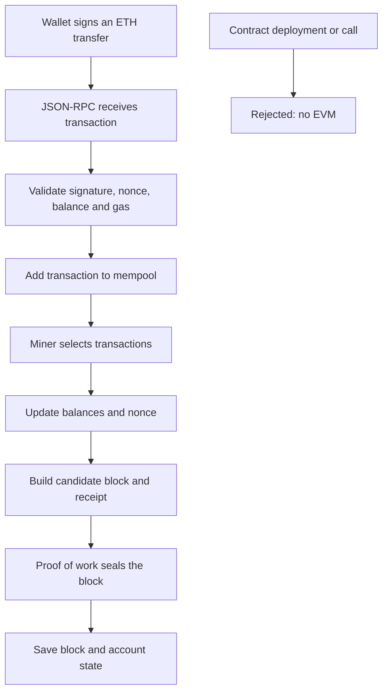
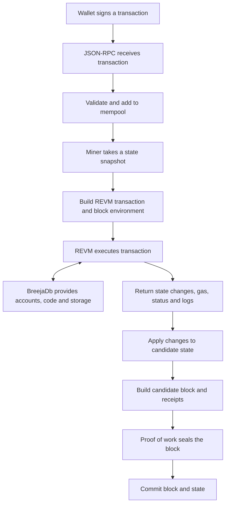
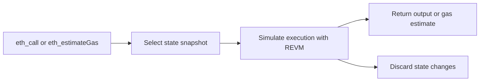

# Adding REVM to the Proof-of-Work Node

## The goal

Extend Breeja, a proof-of-work node that handled ETH transfers, to deploy and execute smart contracts using REVM.

## Before REVM



- Supported signed ETH transfers and proof-of-work mining.
- Had no engine to execute contract bytecode.
- Accounts held balances and nonces; contracts needed code and storage.

## After REVM



- REVM executes ETH transfers, contract deployments, and contract calls.
- Account state now includes contract bytecode and storage.
- Receipts include execution status, gas used, contract addresses, and logs.
- Reverted transactions can be included with a failed receipt and gas charged.

## Read-only contract calls



Additional RPC methods expose contract code, storage, logs, and gas price.

## Code: before and after

### 1. Transaction execution

**Before:** the node directly updated balances and always charged transfer gas. This excerpt is from the original executor:

```rust
let fee = U256::from(TRANSFER_GAS) * U256::from(tx.gas_price);
sender.debit(total)?;
sender.increase_nonce();
accounts.entry(tx.to).or_default().credit(tx.value)?;
accounts.entry(miner).or_default().credit(fee)?;
Ok(TRANSFER_GAS)
```

**After:** the node configures REVM, executes the transaction, and reads its result ([executor.rs](crates/node/src/executor.rs)):

```rust
let mut db = BreejaDb::from_accounts(accounts);
let cfg = CfgEnv::new_with_spec(SpecId::SHANGHAI)
    .with_chain_id(CHAIN_ID);

let mut evm = Context::mainnet()
    .with_db(&mut db)
    .with_block(block_env)
    .with_cfg(cfg)
    .build_mainnet();

let outcome = evm.transact(tx_env)?;
let gas_used = outcome.result.tx_gas_used();
let success = outcome.result.is_success();
```

REVM handles execution and gas accounting; Breeja incorporates the resulting changes into its candidate state.

### 2. Contract creation and calls

Previously every transaction needed a recipient. Now an absent `to` means contract creation ([executor.rs](crates/node/src/executor.rs)):

```rust
let kind = match tx.to {
    Some(to) => TxKind::Call(to),
    None => TxKind::Create,
};

let tx_env = TxEnv {
    caller: tx.from,
    kind,
    value: tx.value,
    data: tx.input.clone(),
    gas_limit: tx.gas,
    // Other transaction fields omitted.
    ..Default::default()
};
```

The transaction retains its input bytes so REVM can execute deployment code or contract calldata.

### 3. State and database adapter

Accounts gained bytecode and storage ([node.rs](crates/primitives/src/node.rs)):

```rust
pub struct Account {
    pub nonce: u64,
    pub balance: U256,
    // Existing code and storage hashes omitted.
    pub code: Option<Bytes>,
    pub storage: HashMap<StorageKey, StorageValue>,
}
```

`BreejaDb` connects that state to REVM through its `Database` interface ([evm.rs](crates/node/src/evm.rs)):

```rust
impl Database for BreejaDb {
    type Error = Infallible;

    // basic() reads account information; code_by_hash() reads bytecode.
    fn storage(&mut self, address: Address, index: StorageKey)
        -> Result<StorageValue, Self::Error>
    {
        Ok(self.accounts.get(&address)
            .and_then(|a| a.storage.get(&index).copied())
            .unwrap_or_default())
    }
    // Remaining trait methods omitted.
}
```

The adapter also implements `DatabaseCommit` to apply REVM's changes to the candidate snapshot.

### 4. Execution results and failed transactions

Previously the transfer path returned a fixed gas value. Now the result records success, gas, created address, logs, and output:

```rust
pub struct TxExecutionResult {
    pub success: bool,
    pub gas_used: u64,
    pub created_address: Option<Address>,
    pub logs: Vec<primitives::node::Log>,
    pub output: Bytes,
}
```

The miner puts successful and reverted executions into blocks, using the result to set the receipt status. Invalid transactions are skipped.

### 5. Simulations

`eth_call` and `eth_estimateGas` execute against a private snapshot. This abbreviated excerpt shows the key distinction ([executor.rs](crates/node/src/executor.rs)):

```rust
let mut db = BreejaDb::from_accounts(accounts);
// Build the EVM using this snapshot and the request.
let outcome = evm.transact(tx_env)?;
// Read outcome.result; do not commit outcome.state.
```

`eth_estimateGas` repeats simulation with different gas limits. Proof-of-work mining remains responsible for sealing actual blocks.

## Live demo

From the `pow-node` directory:

```bash
cargo test -p node solidity_counter_demo -- --nocapture
```

The test starts the miner, deploys a Solidity counter, calls `set(42)`, and checks its storage and emitted event.

Run the full test suite:

```bash
cargo test --workspace
```

## Takeaway

The node validates transactions and mines blocks with proof of work. REVM executes transactions and smart contracts before the candidate block is sealed.
